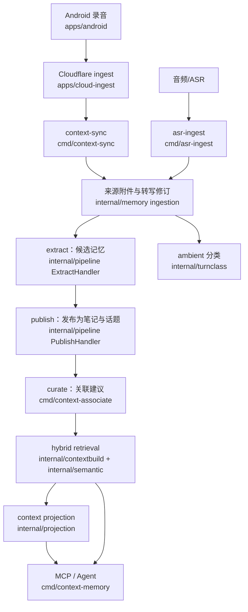

# recording-mcp

A local-first Context Layer that turns long-form recordings into revision-aware, evidence-backed memory consumable through MCP.

把随身录音变成可检索、可审计的会话记忆：转写修订与失效追踪、候选记忆抽取与发布、人工复核的关联与说话人身份、环境音隔离、混合检索（字面 + 语义 + 已确认关联）以及读取时的上下文投影，全部通过 MCP 工具暴露给 agent。所有数据保存在本地 SQLite，不依赖云服务。

## 架构



- 索引与评估旁路：`bin/context-embed` 构建 `memory_embeddings`（迁移 v12），`bin/context-eval` 离线评估检索与投影。
- Worker：`bin/context-worker` 以任务队列租约执行 extract / publish / curate。

## 已实现 / 实验 / 计划

- ✅ 已实现：转写摄入与修订取代（stale 追踪）、extract/publish 候选记忆链路、话题关联提议与人工复核、说话人绑定与修订级身份投影、环境音分离、混合检索（字面 + 语义 + 已确认链接分支 + 融合打分与逐条来源 `retrieval_sources`）、上下文投影 v0（`get_current_context`）、确定性离线评估、任务队列 worker、跨设备采集链路（Android 分块录音 → Cloudflare ingest-v1 → `context-sync` 拉取入库）。
- ✅ 转写配套工具：lite 兜底转写流水线、ASR 修复提案与服务健康判别（`scripts/`，见下文「转写工具链」）。
- 🧪 实验：`build_context` 返回的包结构（items/evidence/coverage/gaps/trace/ranking）、语义后端默认使用离线哈希嵌入器（真实端点可选开启）、投影 v0 的规则集（笔记类型映射与否定线索）。
- 🚧 计划：FTS5 字面索引与字面分支的 n-gram 覆盖率打分、真值引擎（`conflicting` 状态）、模型辅助的投影增强、`project` 记忆类型。

## 快速开始

需要 Go 1.27.1+。

```sh
make build
# 一分钟闭环演示（隔离库 data/demo，无需任何 API key）
make demo

# 真实摄入（转写并入库；需 VOLC_API_KEY）
bin/asr-ingest --db data/context-memory.db --audio recording.wav \
  --conversation-id conv-1 --recording-id rec-1
# 真实提炼（Decision 可选：默认不配 --decision-url 时 extract 照常提炼，只少决策评估）
bin/context-worker --db data/context-memory.db \
  --generator openai --generator-url https://ark.cn-beijing.volces.com/api/v3/chat/completions \
  --generator-key-env GENERATOR_API_KEY
# 不配 generator（默认 off）也可用：只记录覆盖、不产候选，原话仍可检索；
# 发布/摄入后 embed stage 自动增量索引，无需手动跑 context-embed
# 启动 MCP 服务器
bin/context-memory --db data/context-memory.db
```

MCP 客户端里 `tools/list` 可见 27 个工具（19 个记忆工具 + 8 个事件原型工具）。调用 `get_current_context`：

```json
{"jsonrpc":"2.0","id":1,"method":"tools/call",
 "params":{"name":"get_current_context","arguments":{"kinds":["commitment"],"limit":5}}}
```

返回的每个对象携带 `evidence_turn_ids`、`derived_from`、`status`（current/proposed/superseded/unresolved；笔记派生的 commitment/preference 一律 proposed/unconfirmed）与 `conflicts`。

## 跨设备采集（Android → Cloudflare → context-sync）

手机录音 → Cloudflare（Workers + D1 + R2）持久化 → `context-sync` 拉取、校验、转写并复用既有摄入链路。协议契约冻结在 [contracts/ingest-v1](contracts/ingest-v1/README.md)（OpenAPI + 跨语言测试向量，幂等矩阵与 durable ACK 语义见该 README）。

```sh
# 本地云端（wrangler miniflare，无需账号）
cd apps/cloud-ingest && npm ci && npx wrangler d1 migrations apply recording-mcp-ingest --local
npx wrangler dev --port 8787        # 另开终端保持运行

# 管理面签发配对码与 sync token（ADMIN_TOKEN 来自 .dev.vars）
curl -s -X POST localhost:8787/v1/admin/pairing-codes \
  -H "Authorization: Bearer $ADMIN_TOKEN" -H "X-Ingest-Version: ingest-v1" \
  -d '{"owner":"default"}'
curl -s -X POST localhost:8787/v1/admin/sync-tokens \
  -H "Authorization: Bearer $ADMIN_TOKEN" -H "X-Ingest-Version: ingest-v1" \
  -d '{"owner":"default","label":"home-vps"}'

# 模拟录音上传（也是契约客户端验证器：7 种场景含断网恢复/崩溃续传/校验和冲突/缺口）
bin/record-sim --server http://127.0.0.1:8787 --pair-code <PAIRING_CODE> \
  --duration 60s --chunk-seconds 30 --report-json /tmp/sim.json

# 拉取入库（--asr fixture 离线确定性转写；--asr doubao 需 VOLC_API_KEY）
CF_SYNC_TOKEN=<token> bin/context-sync --db data/context-memory.db \
  --server http://127.0.0.1:8787 --sync-token-env CF_SYNC_TOKEN --asr fixture --once
```

Android 端构建与真机说明见 [docs/android.md](docs/android.md)；云端部署/备份见 [docs/cloud-deploy.md](docs/cloud-deploy.md)；端到端场景与故障注入见 [docs/end-to-end.md](docs/end-to-end.md)，一键回归：`make e2e-cloud`（本地 wrangler 全场景）。

## 转写工具链（ASR 配套）

围绕 `asr-ingest` 的三个离线辅助工具（Python 3 标准库 + ffmpeg/ffprobe；key 走环境变量或
`--key`，不落盘）：

| 工具 | 用途 |
| --- | --- |
| `scripts/lite-transcribe.py` | ASR plan 配额不可用时的兜底转写：`doubao-seed-2.1-lite` 多模态逐字转写，静音对齐分块、VAD 跳过无人声块、逐块质检与块首补转、断点续跑，输出带 `[mm:ss]` 标记的逐字稿（[docs/lite-transcribe.md](docs/lite-transcribe.md)） |
| `scripts/asr-repair.py` | 定向修复：库内 ASR 与 lite 稿按时间分桶比对，最差分歧跨度出提案（`repairs.md`）；仅对空/`(听不清)` 密集的 turn 受控落库，原文留档可回溯（[docs/asr-repair.md](docs/asr-repair.md)） |
| `scripts/asr-health.sh` | `asr-ingest` 批量失败时的三层判别（DNS / TLS / 会话探针），区分网络故障与服务端配额拒绝，`--wait` 轮询恢复后可接续补跑（[docs/asr-health.md](docs/asr-health.md)） |

典型补录流程：`asr-health.sh` 确认配额状态 → 可用则 `asr-ingest` 正常入库；不可用则
`lite-transcribe.py` 出逐字稿，恢复后再 `asr-ingest` 补库、`asr-repair.py` 做质量对齐。

## 核心概念

- **转写修订（transcript revision）**：同一片段的 ASR 结果按 `transcript_revision` 版本化，`supersedes_revision` 声明取代关系；旧修订保留为审计历史。
- **stale**：被取代修订派生的笔记/轮次标记为失效，不再出现在任何当前检索中。
- **证据（evidence）**：每条派生记忆都引用其来源轮次；证据永远是当前状态的。
- **记忆候选（memory candidate）**：extract 阶段生成的结构化记忆提案，publish 校验后成为会话注释。
- **已确认关联（confirmed link）**：人工复核通过的话题关联；它是复核裁决而非来源事实，可作为检索的排序分支。
- **说话人投影（speaker projection）**：人工确认的 speaker binding 按（录音，转录修订）解析为 person id。
- **ambient turn**：语音助手指令、广播、自助点餐提示等环境音，默认与对话内容隔离，仅在显式参数下可见。
- **混合检索（hybrid retrieval）**：字面子串、向量相似、导航与已确认链接四个分支按固定权重融合，逐条携带 `retrieval_sources`。
- **上下文投影（context projection）**：读取时从当前证据推导 person/topic/commitment/preference/event 对象，带状态与冲突。intention/request/constraint 派生的对象一律为 `proposed`/`unconfirmed`——没有自动确认路径，消费方不得把 proposed 对象当作已确认事实。

## MCP 工具

| 家族 | 工具 | 用途 |
| --- | --- | --- |
| 记忆写入（5） | `ingest_transcript`、`apply_annotations`、`review_memory_link`、`propose_speaker_binding`、`review_speaker_binding` | 摄入转写、应用注释修订、复核关联与说话人绑定 |
| 检索与读取（14） | `search_memory`、`query_context`、`get_conversation_context`、`get_context_item`、`list_conversations`、`list_topics`、`get_evidence_context`、`get_processing_status`、`get_annotation_history`、`build_context`、`get_current_context`、`list_memory_links`、`get_speaker_projection`、`list_speaker_bindings` | 字面/混合检索、上下文包、当前上下文投影、历史与状态 |
| 事件原型（8） | `search_events`、`get_timeline`、`get_commitments`、`get_conversation_events`、`get_person_context`、`get_current_state`、`ingest_events`、`record_feedback` | 独立的事件原型，与记忆家族共用同一数据库与服务 |

记忆家族共 19 个工具（14 只读 + 5 写入）；事件原型工具由同一二进制提供。精确字段以 [docs/contract.md](docs/contract.md) 与 [docs/context-layer-runtime.md](docs/context-layer-runtime.md) 为准。

## 安全与信任语义

- 生成的记忆可能出错：自动注释未经人工复核，消费方应自行核对证据。
- 已确认关联是复核裁决，不是来源事实；stale 的关联不再参与当前检索。
- 原始证据始终是权威：任何派生对象都能回溯到转录轮次。
- 失效历史保留用于审计，不参与当前结果。
- ambient 音频默认隔离，只在显式参数下可见。
- 语义索引绝不会复活 stale 行：查询路径与字面路径使用同一套当前状态过滤。

## 许可证

本项目以 [GNU AGPL-3.0](LICENSE) 发布（SPDX: `AGPL-3.0-only`）。该协议允许商用；按 §13 网络条款，任何人通过网络（如 SaaS/MCP 服务）使用本软件的修改版本，必须向其使用者提供对应的完整源码。依赖均为宽松协议（BSD-3 / BSD-2），与 AGPL 无冲突。
