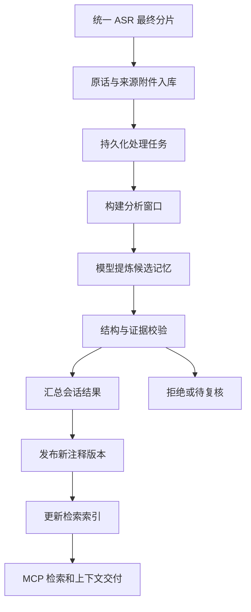

# Context Layer 开发执行计划

面向 coding team，目标是把当前能够保存和查询转写的实验实现，推进为可持续处理录音历史、可供 Agent 可靠检索的 Context Layer。下一阶段以处理流程和检索为主，先完成一个可恢复、可追溯的闭环，再加入人物关联与更完整的来源修订。

本文为实施计划，新增的表、模块和工具均是拟议接口，不能当作现有能力。当前已实现能力以 [运行说明](context-layer-runtime.md) 和代码为准。领域草案见 [内部规范](specs/internal-context-0.1.md) 与 [MCP 规范](specs/context-mcp-0.1.md)。

## 当前基础与最需要补的部分

现有链路是供应商响应 → Adapter → `asr-input/0.1` → SQLite 原话与来源附件 → `apply_annotations` → MCP 查询。已有重复输入校验、注释版本历史、原话证据引用和处理状态。

下一阶段的关键缺口：

| 优先级 | 扩写项 | 要解决的问题 |
| --- | --- | --- |
| P0 | 持久化任务与处理记录 | 接收后自动推进；失败、重启、重复执行不会丢任务或重复发布 |
| P0 | 分段提炼和会话合并 | 长录音无需一次送给模型；各分段结果能汇成一致的会话记忆 |
| P0 | 证据校验与发布门槛 | 模型输出必须引用真实原话，建议和意向不会变成已确认事实 |
| P0 | 会话发现、原话邻近展开、中文检索 | Agent 能找到某次沟通，理解命中句的前后文 |
| P1 | 话题和人物关联 | 可以跨会话找同一主题，或查询和已确认人物的沟通历史 |
| P1 | 语义检索和上下文装配 | 不依赖完全相同的关键词，返回适合当前任务的信息量 |
| P2 | 转写更正及依赖失效 | 上游重新识别后，旧摘要和索引不会继续冒充最新结果 |

## 处理链路及各层职责

接收层负责可靠保存来源；处理层负责安排加工、记录运行结果；记忆层决定哪些派生内容可以发布；检索层组织可查的索引；MCP 提供 Agent 使用的边界。模型负责提出解释，程序负责验证引用、版本和发布条件。

处理状态必须拆开：来源已接收、某个分析范围已处理、解释已人工复核、整段录音已声明上传结束，是不同事情。不能用话题关联比例代表分析完整度。经处理但没有值得提炼的原话，也应该计入分析覆盖。

## 与 JEV 配合的边界

目前项目资料中没有 JEV 的定义、仓库或接口。这里暂按“可承担任务执行或模型调用的外部运行环境”设计对接边界；这是假设，不代表已核实 JEV 有这些能力。确认其实际职责后再决定接入方式。

无论执行器是谁，Context Layer 保持记忆、来源、版本与发布记录的权威存储。外部执行器按任务读取明确的输入范围，返回候选结果，不直接修改 SQLite。先实现一个本地执行器与合成执行器，JEV Adapter 后续遵循同一任务契约接入。

### 拟议任务契约

请求至少包括：`job_id`、`stage`、`input_snapshot_id`、`conversation_id`、原话 ID 与转写版本、分析窗口与上下文窗口、输出 schema 版本、处理器版本、输出与成本上限。实例化大模型时另记录模型、提示模板版本及实际请求 ID。

响应至少包括：`job_id`、本次执行尝试 ID、租约令牌、候选结果或结果引用、输入快照 ID、覆盖原话 IDs、完成状态、用量、耗时以及结构化错误。模型自报“完成”不能替代服务端覆盖和证据校验。

原话只随当前任务的必要范围传递，凭据通过运行配置提供。处理结果必须能追溯到任务、执行尝试、输入快照与处理器版本。

### 确认 JEV 后的选择

| JEV 的实际职责 | 配合方式 |
| --- | --- |
| 任务运行器或 Agent Runtime | 通过 Adapter 领取和返回处理任务，复用其并发、模型调用及运行日志能力 |
| 模型 API 或代理网关 | 仅实现模型客户端；任务、重试和发布仍由本项目管理 |
| coding team 的开发平台 | 用本文拆任务和验收；产品运行时无需依赖 JEV |

待确认项目地址、调用方式、运行位置、并发/取消机制、是否支持结构化输出及凭据管理。确认前不引入特定 JEV SDK，也不声称已经集成。

## 处理任务和存储契约

建议新增模块 `internal/process`，迁移逻辑集中到 `internal/migrations`。保留 SQLite，首期用数据库任务队列与一个独立 Worker 命令即可，不先引入额外消息中间件。

拟议新增实体：

| 实体 | 必需内容及用途 |
| --- | --- |
| `processing_jobs` | 阶段、输入快照、幂等键、状态、依赖、优先级、重试时间、租约和最大尝试次数 |
| `processing_attempts` | 每次执行、Worker、模型与处理器版本、开始/结束时间、错误、用量与结果引用 |
| `processing_windows` | 有序原话 IDs、负责分析范围、补充上下文范围及对应转写版本 |
| `memory_candidates` | 候选话题和记忆、证据 IDs、校验状态、拒绝理由、来源 attempt |
| `analysis_coverage` | 明确处理过的原话 IDs/范围、快照、处理器版本与结果状态 |
| `publication_runs` | 合并输入、预期注释版本、生成版本、提交状态与发布后的索引任务 |

任务状态采用 `queued → running → succeeded`；可重试失败进入 `retry_wait`，超限或不可修复错误进入 `failed`；取消进入 `cancelled`。依赖未就绪不可领取。租约过期可以重新执行，但已失去租约的 Worker 无权发布结果。

幂等键由阶段、不可变输入快照、窗口定义、处理器配置/版本计算。一次语义任务有多次执行尝试；重复执行允许发生，最终发布只接受一个有效结果。单纯更换网络请求 ID 不会形成新业务任务。

来源保存和创建处理任务应处在同一事务，或者采用同事务 outbox。模型调用必须在数据库事务之外。租约领取使用原子条件更新；续租、取消与最终确认都校验当前令牌。

注释发布和创建索引任务同样采用事务或 outbox，防止“记忆已发布，索引任务丢失”。索引更新可重放并按发布版本区分。

### 旧数据兼容

现有数据库有数据且没有正式迁移版本。先建立 schema version 和迁移测试，包含旧库副本升级、失败恢复和回滚策略。旧资料通过回填任务进入处理流程；不要求重录或重跑 ASR。回填与实时接收必须使用相同幂等规则。

目前 `turns.speaker_entity_id` 有只能为 NULL 的约束，人物关联不能直接 UPDATE 这个字段。人物绑定优先放在独立关系表和读投影中，后续调整字段需显式迁移。

## 长录音如何加工成记忆

### 构建窗口

窗口依据稳定的原话顺序和实际模型输入预算构建。顺序不能沿用当前随机哈希 ID 的排序：保留 `original_index`，结合分片偏移、已知时间与来源顺序；缺失时间依然有确定的来源序。

每个窗口分为负责分析的原话和前后补充上下文。补充原话可以帮助理解，但不计入该窗口完成覆盖。重复窗口或上下文交叠不能生成重复发布记录。

首期接受上游显式 `conversation_id`。模型可建议会话切分，但暂不自动改归属。目前一条录音只归属一个会话；后续需要转为会话与来源范围关系，才能支持同录音多次沟通及跨录音会话。

### 提炼候选

首期输出现有五类讨论记忆：观察、建议、请求、约束、意向，并附话题候选与完整证据 turn IDs。被提及人物和实际说话人分开记录；提到“陈先生”不代表该句由陈先生说出。

每条候选保留结构化文本、引用、覆盖范围、模型/提示版本和输入快照。没有证据或不确定的内容可被标记为待复核，不能补猜真实身份、日期或承诺状态。首期不从讨论记录自动生成承诺生命周期。

完整分析可以产出零条记忆；失败或只处理部分输入则必须显式记录。区分 `no_findings` 和 `failed`，否则“没提炼出来”会被误当成“没发生”。

### 校验与合并

校验至少包含输出 schema、证据存在、引用版本一致、证据在允许范围内、类别合法和未超预算。确定性校验无法保证自然语言含义正确，语义质量由合成评测、抽查和必要的人工复核承担。

先做可确定的重复候选去重；同名话题和近似语句生成关联建议，不直接永久合并。对跨窗口冲突保留不同陈述及证据，不采用“最新一句必定正确”的规则。

### 发布

现有 `ApplyAnnotations` 是会话完整替换。分段 Worker 只能提交候选，不能各自调用它。一个会话发布器读取候选快照、保留已确认的修订结果，构建完整注释视图，再带 `expected_version` 原子提交。

遇到版本冲突须重新读取并合并，不能盲目换一个新版本重试。已有人工修订必须明确保存来源与优先级，避免下一次自动分析覆盖。

发布前确认输入快照仍有效。新分片到达时，新建包含新增范围的任务；旧结果保留其明确覆盖范围，不把旧分析进度扩成整个会话完成。

## 检索与 MCP 扩展

首批补三个工具；第二批再补预算化上下文装配。现有工具继续可用，新工具使用独立契约版本，不宣称已完整兼容领域草案。

| 拟议工具 | 输入重点 | 返回重点 |
| --- | --- | --- |
| `list_conversations` | 时间范围、来源、人物/话题、处理状态、分页游标 | 会话标题、已知时间、来源范围、身份与分析覆盖情况 |
| `get_evidence_context` | 命中 turn ID、前后轮数、同录音限制、大小上限 | 有序邻近原话、原话定位、版本和截断标志 |
| `search_memory` | 文本、原话/派生记忆范围、时间、人物、话题、检索模式 | 命中、排名理由、证据、快照、下一页、降级情况 |
| `build_context` | 目的、消费者、筛选范围、字节/token 预算 | 精简记忆与引用、覆盖和缺口、截断、所用版本 |

`get_evidence_context` 是显式展开请求，不让普通关键词命中隐式返回整场会话。跨录音没有可信绝对时间时，不假装按现实时间排序。查询“上周”时，未知绝对时间的录音不能凭文件名算入范围。

第一阶段先改善中文词法检索和排序，基于合成数据验证，再增加可替换 embedding provider。中文 tokenizer 不默认假设能正确处理单字和中文词；选型前用实际分词/召回测试验收。语义和词法检索结合，模型不可用时回退词法并明确标记。

索引保存模型与配置版本、输入内容哈希、注释版本及可见性。默认不交付过时记忆，索引落后时可直接查询当前存储或明确降级，不能混用旧索引结果冒充新版本。

新检索接口固定查询快照，提供稳定游标和输出大小上限；当前 offset 接口仅保留实验兼容。返回区分 `raw_turn`、`derived_memory`、`identity_link`，并统一带 provenance、claim mode、处理覆盖、截断和缺失信息。模型生成的打分不直接称作概率。

## 人物和话题关联

人物首期支持手工确认、撤销和拒绝关联，建议使用 `speaker_bindings` 保存来源限定标签、人物 entity ID、依据、确认者和版本。确认范围至少限定设备、录音、请求/转写版本；不能把供应商的 speaker 0 全局绑定到某个人。

后续接收外部声纹识别结果作为候选依据，本层不实现声学识别。跨片候选关联只影响建议视图；确认后才用于“和谁聊过什么”查询。撤销应更新读投影和索引，保留历史依据。

话题使用稳定 ID、别名和带版本的合并关系。模型先提交候选话题，确定性 ID 由服务生成；需要重命名时保留 ID，不因为显示名变化重新生成全部记忆。

## 修订与运行管理

转写修订、会话归属修订、注释修订和人物绑定修订分别建模。新转写替代旧转写后，依赖旧句子的候选、摘要、索引应被标记为 stale，默认查询隐藏或明确隔离，随后创建重新分析任务。旧输入和旧版本仍可审计。

若将来需要删除私人数据，删除过程必须涵盖来源附件、原话、模型输入输出、派生记忆、任务结果及索引，不能只删除主表。公开仓库测试只使用合成样例；真实数据保留在本地忽略目录。

运行管理首期提供 CLI：列任务、查看失败、重试、取消、查看某会话处理进度与最近发布记录。普通检索 Agent 不需要领取任务或控制 Worker；运行管理接口和消费 MCP 分开配置。

## Coding team 分工与合并顺序

以下职责可分配给人或 coding agents。所有成员共享仓库，不能回退其他成员的改动。公共 DTO 和数据库迁移先由集成负责人定稿；每个任务维护自己的契约测试和文档。

| 工作包 | 负责范围 | 前置依赖 | 必须交付 |
| --- | --- | --- | --- |
| A 存储与任务 | migrations、任务仓库、outbox、覆盖与版本记录 | 无 | 旧库升级；原子排队；租约、重试与幂等测试 |
| B 执行器与 JEV | Worker、模型客户端、执行器接口、配置 | A 的任务 DTO；JEV 定义待确认 | 合成/本地执行器；断连、超时、取消与用量记录 |
| C 提炼与发布 | 窗口、候选 schema、校验、聚合发布 | A；B 的合成执行器 | 长会话处理；证据校验；冲突与人工修订保留 |
| D 检索与消费 MCP | 会话发现、邻近展开、词法/语义检索、预算交付 | A 的快照/版本 DTO | 三个首批工具；分页、中文检索与缺失字段测试 |
| E 关联与失效 | 人物绑定、话题关系、来源更正、失效传播 | A；C/D 的版本接口 | 确认/撤销；stale 隔离；索引更新 |
| F 集成与评测 | 合成数据集、端到端测试、运行文档、CI | 持续参与 | 用例和门槛；每阶段演示；统一 migration 合并 |

建议并行安排：A 先冻结基础契约；B、C、D、F 依据接口并行；首个闭环通过后推进 E 和语义检索。A/F 负责统一数据库迁移入口，避免多个 Worker 各自在 `Open()` 中随意扩表。

现有关键入口：`internal/asrinput`、`internal/memory/ingestion.go`、`internal/memory/revisions.go`、`cmd/context-memory/main.go`。模型或 JEV 依赖不能进入 `internal/asrinput` 和供应商 Adapter。

## 阶段验收

### 第一阶段 可持续处理闭环

合成 ASR 输入落库后，自动产生任务；Worker 分窗提炼；服务校验证据；会话发布器提交注释；Agent 能发现会话并查看命中句前后文。重启、重复输入和一次模型失败都可恢复，无需手工写 annotations 文件。

验收包括：两个合成 ASR 供应商；缺失时间/说话人；空白及静音；乱序和迟到分片；超过一个分析窗口的长会话；无可提炼内容；模型非法引用；并发发布；已有人工修订。旧实验 CLI 和 MCP 查询回归通过。

故障注入至少覆盖：来源已保存但排队前中断、领取后 Worker 退出、模型已返回但发布前中断、发布成功但索引未处理。每种情况重启后不丢任务、不重复发布、原话不变。

### 第二阶段 跨会话可检索记忆

支持语义与词法混合检索、话题别名、人工人物绑定和按预算构建上下文。合成评测固定至少 30 个查询，涵盖同义表达、否定、建议/承诺区别、多场会话与未知人物。

建议门槛：不少于 90% 的评测查询在前 5 条命中人工指定的有效证据；无效证据引用全部拒绝；未知人物不得自动实名；过滤条件与大小上限必须严格满足。这是待团队确认的目标，不是当前结果；没有相关证据的查询应返回空结果和覆盖信息。

### 第三阶段 来源修订与更完整契约

允许显式替换转写及修订会话归属，旧依赖及时失效，历史快照可回看；补齐来源范围关系、数据删除、契约兼容说明和可重建索引。此阶段再逐项对齐 0.1 草案，不把实验接口悄悄更名成正式实现。

每个阶段交付演示命令、合成输入和验收结果。运行 `make test`、`make build` 和 `go vet ./...`；按新增能力补故障和语义评测，不以构建通过代替产品验收。

## 首个可直接派发的任务

先做 A 的最小切片：新增正式迁移入口、`processing_jobs` 与 `processing_attempts`；让 `IngestTranscript` 和创建一个处理任务原子提交；写一个使用合成执行器的 Worker，支持领取、成功、失败、租约恢复和幂等重放。

这一步暂不调用真实模型，也无需确定 JEV。验收是：同一分片重复导入只产生一个业务任务；Worker 被终止后任务可被另一实例恢复；失去租约的旧 Worker 无权完成任务；旧数据仍能通过原 MCP 查询。

完成该切片后，B 接真实执行器，C 接提炼与发布，D 完善 Agent 检索。这样每一阶段都有可运行、可检查的结果。
