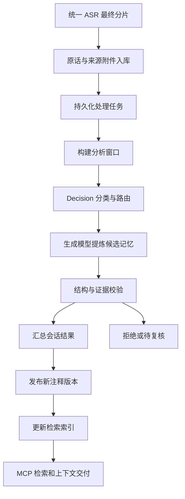

# Context Layer 开发执行计划

面向 coding team，目标是把当前能够保存和查询转写的实验实现，推进为可持续处理录音历史、可供 Agent 可靠检索的 Context Layer。下一阶段以处理流程和检索为主，先完成一个可恢复、可追溯的闭环，再加入人物关联与更完整的来源修订。

本文为实施计划，新增的表、模块和工具均是拟议接口，不能当作现有能力。当前已实现能力以 [运行说明](context-layer-runtime.md) 和代码为准。领域草案见 [内部规范](specs/internal-context-0.1.md) 与 [MCP 规范](specs/context-mcp-0.1.md)。

## 当前基础与最需要补的部分

现有链路是供应商响应 → Adapter → `asr-input/0.1` → SQLite 原话与来源附件 → `apply_annotations` → MCP 查询。已有重复输入校验、注释版本历史、原话证据引用和处理状态。

下一阶段的关键缺口：

| 优先级 | 扩写项 | 要解决的问题 |
| --- | --- | --- |
| P0 | 持久化任务与处理记录 | 接收后自动推进；失败、重启、重复执行不会丢任务或重复发布 |
| P0 | 分段提炼和会话合并 | 长录音无需一次送给模型；各分段结果能汇成一致的会话记忆 |
| P0 | 证据校验与发布门槛 | 模型输出必须引用真实原话，建议和意向不会变成已确认事实 |
| P0 | 会话发现、原话邻近展开、中文检索 | Agent 能找到某次沟通，理解命中句的前后文 |
| P1 | 话题和人物关联 | 可以跨会话找同一主题，或查询和已确认人物的沟通历史 |
| P1 | 语义检索和上下文装配 | 不依赖完全相同的关键词，返回适合当前任务的信息量 |
| P2 | 转写更正及依赖失效 | 上游重新识别后，旧摘要和索引不会继续冒充最新结果 |

## 处理链路及各层职责



接收层负责可靠保存来源；处理层负责安排加工、记录运行结果；记忆层决定哪些派生内容可以发布；检索层组织可查的索引；MCP 提供 Agent 使用的边界。模型负责提出解释，程序负责验证引用、版本和发布条件。

处理状态必须拆开：来源已接收、某个分析范围已处理、解释已人工复核、整段录音已声明上传结束，是不同事情。不能用话题关联比例代表分析完整度。经处理但没有值得提炼的原话，也应该计入分析覆盖。

## Jev 与 Decision 的具体分工

本计划采用 Jevbox 的层级检索思路、TypeSafe Jev 的决策接口，以及可本地部署的 Decision 2.0 模型。Worker、租约和发布由本项目负责；决策模型作为可替换的判断服务接入。

| 参考项目 | 已核实的能力 | 在本项目的用途 |
| --- | --- | --- |
| [Jevbox 检索架构](https://github.com/extend-hq/jevbox/blob/7e4562124c49d0e6a527609e872b7627e00ef604/docs/retrieval.md) | Choice 导航层级，再独立评估原始 passage 的用途 | 借鉴导航、证据评分、探索预算与检索轨迹；将文档结构改为录音记忆视图 |
| [Decision 2.0 Kai 模型卡](https://huggingface.co/vllm-sr/Decision-2.0-Kai-0.6B/blob/cd49ea3813fd8ba0928a9a23ef6c9a0f2f0cd764/README.md) | 对同一 state 的 Choice、Yes/No、Score 问题返回分布，不生成文本 | 本地执行分类、路由、关联候选判断和证据相关性评分 |
| [pg-jev](https://github.com/realZachi/pg-jev/blob/8d9598d87d5ff460998d91ec070226176024a841/README.md) | PostgreSQL 函数调用 TypeSafe Jev 判断行内容 | 借鉴语义谓词和批量判断形式；当前不安装扩展或迁移数据库 |

这是经过来源核对的集成设计，尚未完成部署或准确率测试。Jevbox 当前使用 TypeSafe 托管服务，不能假定它已提供 Decision 2.0 Adapter；两个模型的 wire schema、分数和校准也不能直接互换。

### Process 层增加决策步骤

```text
原话和来源先保存
  → 分析窗口
  → Decision 多问题判断
      内容类别 / 现有话题候选 / 是否需进一步提炼 / 是否模糊
  → 按策略选择生成模型或保留待处理范围
  → 生成模型提炼文本与引用
  → 程序校验证据 + Decision 提供语义复核信号
  → 会话合并发布
```

Decision 负责回答有限选项的问题；生成模型负责创造摘要、新话题名称及记忆文本。初期决策处于 shadow 模式：记录建议和成本，但不凭判断结果跳过基线提炼。评测通过后逐个启用路由，不把不确定内容丢弃或从原话存储中删除。

建议首批问题：窗口涉及哪些现有话题、是否含建议/请求/意向、是否有多个不相干主题、是否需要补充前后文。多标签用独立 Yes/No 问题；单一 Choice 包含 mixed/other，业务策略另提供 abstain。模型回答概率不是内容被核实的概率。

### 统一 DecisionEngine

增加 `internal/decision`，提供自己的版本化 `Evaluate(state, questions)` 契约。问题包含 ID、类型、完整说明和选项/rubric；结果包含每个选项的分布、实际模型与权重版本、输入哈希、rubric 版本、用量、耗时及错误。不把模型特有 payload 直接变成 MCP 公共契约。

至少提供三个 Adapter：合成确定性实现、本地 Decision 2.0 服务、可选 TypeSafe 托管 Jev。Go Worker 调用自定义决策 HTTP 服务；本地服务可用 Python 加载固定版本权重并调用模型卡中的 `system_one`。此服务不是聊天补全端点，也不假定 OpenAI-compatible 接口可直接加载这些模型。

Choice 必须返回请求中的完整选项分布；Yes/No 按 Adapter 显式映射；Score 保留有序 rubric 分布，期望分数由服务计算。验证有限数值、范围、和、选项一致性及问题齐全。非法结果整次拒绝，不拿缺失回答当 No。

同一窗口可一次询问多种问题。不同窗口可批量调度，但必须有独立 ID 和答案映射，不能让其他窗口的文字替代当前窗口证据。超过模型输入预算要重新分窗或拒绝，不允许静默截断。缓存键包含输入哈希、问题/选项、模型权重、预处理与 rubric 版本。

### 模型选择与校准

第一轮在同一台样机测 [Kai 0.6B](https://huggingface.co/vllm-sr/Decision-2.0-Kai-0.6B)、[Eos 0.8B](https://huggingface.co/vllm-sr/Decision-2.0-Eos-0.8B) 与 [Sol 2B](https://huggingface.co/vllm-sr/Decision-2.0-Sol-2B)。模型卡声明上下文分别为 8,192、16,384、16,384 tokens；这不是本项目已经测得的吞吐或可用硬件要求。

用中文口语、ASR 错字、否定、反问、多个话题和未确认身份测自己的工作负载。记录误判、保留关键内容的召回、拒答率、端到端 p50/p95、冷启动、内存/显存、批量吞吐与功耗；没有功耗测量设备就标记未测。所有候选使用同一数据划分、窗口和 rubric，阈值在校准集确定，在独立测试集报告结果。

大模型基线和小模型路由使用相同冻结数据对比：不仅看少花多少生成调用，还看漏掉多少关键原话。模型方的毫秒级 benchmark 不写成本项目 SLA，先不指定获胜模型或最低硬件。

### Worker 任务契约

任务请求保留 `job_id`、`stage`、`input_snapshot_id`、会话与原话版本、负责范围和上下文范围、处理器/输出 schema 版本与成本上限。执行器返回 attempt ID、租约令牌、输入快照、覆盖 IDs、候选结果、用量和结构化错误。

Decision 判断另保存 `decision_runs` 和 `decision_answers`；处理覆盖、语义判断、生成候选及最终发布之间建立来源链。`deferred_by_policy` 是暂未提炼，不等于 `no_findings`；Decision 拒答或服务不可用时按显式策略退回基线、留待重试或报告错误。

原话、版本与发布记录仍以 Context Layer 为权威，模型服务不能直接修改 SQLite。

## 处理任务和存储契约

建议新增模块 `internal/process`，迁移逻辑集中到 `internal/migrations`。保留 SQLite，首期用数据库任务队列与一个独立 Worker 命令即可，不先引入额外消息中间件。

拟议新增实体：

| 实体 | 必需内容及用途 |
| --- | --- |
| `processing_jobs` | 阶段、输入快照、幂等键、状态、依赖、优先级、重试时间、租约和最大尝试次数 |
| `processing_attempts` | 每次执行、Worker、模型与处理器版本、开始/结束时间、错误、用量与结果引用 |
| `processing_windows` | 有序原话 IDs、负责分析范围、补充上下文范围及对应转写版本 |
| `decision_runs` / `decision_answers` | 输入和问题版本、后端/权重、分布、策略决定、用量、attempt 与缓存来源 |
| `retrieval_nodes` / `retrieval_edges` / `passage_refs` | 可重建的层级视图、关系版本、来源 passage 引用；叶子回指原话 |
| `memory_candidates` | 候选话题和记忆、证据 IDs、校验状态、拒绝理由、来源 attempt |
| `analysis_coverage` | 明确处理过的原话 IDs/范围、快照、处理器版本与结果状态 |
| `publication_runs` | 合并输入、预期注释版本、生成版本、提交状态与发布后的索引任务 |

任务状态采用 `queued → running → succeeded`；可重试失败进入 `retry_wait`，超限或不可修复错误进入 `failed`；取消进入 `cancelled`。依赖未就绪不可领取。租约过期可以重新执行，但已失去租约的 Worker 无权发布结果。

幂等键由阶段、不可变输入快照、窗口定义、处理器配置/版本计算。一次语义任务有多次执行尝试；重复执行允许发生，最终发布只接受一个有效结果。单纯更换网络请求 ID 不会形成新业务任务。

来源保存和创建处理任务应处在同一事务，或者采用同事务 outbox。模型调用必须在数据库事务之外。租约领取使用原子条件更新；续租、取消与最终确认都校验当前令牌。

注释发布和创建索引任务同样采用事务或 outbox，防止“记忆已发布，索引任务丢失”。索引更新可重放并按发布版本区分。

### 旧数据兼容

现有数据库有数据且没有正式迁移版本。先建立 schema version 和迁移测试，包含旧库副本升级、失败恢复和回滚策略。旧资料通过回填任务进入处理流程；不要求重录或重跑 ASR。回填与实时接收必须使用相同幂等规则。

目前 `turns.speaker_entity_id` 有只能为 NULL 的约束，人物关联不能直接 UPDATE 这个字段。人物绑定优先放在独立关系表和读投影中，后续调整字段需显式迁移。

## 长录音如何加工成记忆

### 构建窗口

窗口依据稳定的原话顺序和实际模型输入预算构建。顺序不能沿用当前随机哈希 ID 的排序：保留 `original_index`，结合分片偏移、已知时间与来源顺序；缺失时间依然有确定的来源序。

每个窗口分为负责分析的原话和前后补充上下文。补充原话可以帮助理解，但不计入该窗口完成覆盖。重复窗口或上下文交叠不能生成重复发布记录。

首期接受上游显式 `conversation_id`。模型可建议会话切分，但暂不自动改归属。目前一条录音只归属一个会话；后续需要转为会话与来源范围关系，才能支持同录音多次沟通及跨录音会话。

### 提炼候选

首期输出现有五类讨论记忆：观察、建议、请求、约束、意向，并附话题候选与完整证据 turn IDs。被提及人物和实际说话人分开记录；提到“陈先生”不代表该句由陈先生说出。

每条候选保留结构化文本、引用、覆盖范围、模型/提示版本和输入快照。没有证据或不确定的内容可被标记为待复核，不能补猜真实身份、日期或承诺状态。首期不从讨论记录自动生成承诺生命周期。

完整分析可以产出零条记忆；失败或只处理部分输入则必须显式记录。区分 `no_findings` 和 `failed`，否则“没提炼出来”会被误当成“没发生”。

### 校验与合并

校验至少包含输出 schema、证据存在、引用版本一致、证据在允许范围内、类别合法和未超预算。确定性校验无法保证自然语言含义正确，语义质量由合成评测、抽查和必要的人工复核承担。

先做可确定的重复候选去重；同名话题和近似语句生成关联建议，不直接永久合并。对跨窗口冲突保留不同陈述及证据，不采用“最新一句必定正确”的规则。

### 发布

现有 `ApplyAnnotations` 是会话完整替换。分段 Worker 只能提交候选，不能各自调用它。一个会话发布器读取候选快照、保留已确认的修订结果，构建完整注释视图，再带 `expected_version` 原子提交。

遇到版本冲突须重新读取并合并，不能盲目换一个新版本重试。已有人工修订必须明确保存来源与优先级，避免下一次自动分析覆盖。

发布前确认输入快照仍有效。新分片到达时，新建包含新增范围的任务；旧结果保留其明确覆盖范围，不把旧分析进度扩成整个会话完成。

## 检索与 MCP 扩展

首批补三个工具；第二批再补预算化上下文装配。现有工具继续可用，新工具使用独立契约版本，不宣称已完整兼容领域草案。

| 拟议工具 | 输入重点 | 返回重点 |
| --- | --- | --- |
| `list_conversations` | 时间范围、来源、人物/话题、处理状态、分页游标 | 会话标题、已知时间、来源范围、身份与分析覆盖情况 |
| `get_evidence_context` | 命中 turn ID、前后轮数、同录音限制、大小上限 | 有序邻近原话、原话定位、版本和截断标志 |
| `search_memory` | 文本、原话/派生记忆范围、时间、人物、话题、检索模式 | 命中、排名理由、证据、快照、下一页、降级情况 |
| `build_context` | 目的、消费者、筛选范围、字节/token 预算 | 精简记忆与引用、覆盖和缺口、截断、所用版本 |

`get_evidence_context` 是显式展开请求，不让普通关键词命中隐式返回整场会话。跨录音没有可信绝对时间时，不假装按现实时间排序。查询“上周”时，未知绝对时间的录音不能凭文件名算入范围。

第一阶段建立中文词法基线和明确范围过滤；第二阶段主线是 Jevbox 风格的层级导航加 Decision 证据评分。embedding 为可选对照或召回支路，按评测决定是否加入，不作为主线前置依赖。中文分词必须以测试验收。决策服务不可用时回退词法需明确降级，也可按 strict 模式报错；不能把故障包装成正常的零结果。

索引保存模型与配置版本、输入内容哈希、注释版本及可见性。默认不交付过时记忆，索引落后时可直接查询当前存储或明确降级，不能混用旧索引结果冒充新版本。

新检索接口固定查询快照，提供稳定游标和输出大小上限；当前 offset 接口仅保留实验兼容。返回区分 `raw_turn`、`derived_memory`、`identity_link`，并统一带 provenance、claim mode、处理覆盖、截断和缺失信息。模型生成的打分不直接称作概率。

### 将录音记忆组织成可导航视图

拟议结构为“入口视图 → 话题/已确认人物/时间范围 → 会话 → 分析窗口 → 原话 passage”。这些是同一份记忆的多个索引入口，不是复制多份原话。一条 passage 可出现在多个路径中，但始终回指相同来源 IDs；评分和输出按 passage ID 去重。

录音没有文档标题与章节，不能直接套用 Jevbox 的文档树。时间/来源结构先由程序建立，话题结构从已发布注释生成，人物入口仅包含确认绑定；尚未分析的会话始终保留来源入口。模型生成的章节描述须标为派生内容，树本身不是证据。

检索过程按以下顺序实现：

1. 先应用权限、来源版本和调用方明确的范围过滤。时间、ID 和权限由程序判断，不交给决策模型猜。
2. 提供若干相关视图入口及词法候选支路。只有传入的兄弟节点可以成为 Choice 选项；保留 none，未知或弱路由暂缓后仍可探索。
3. 用有界 beam search 保留多个路径，逐层读取有限描述。单层选项过多先分组，不能跨不相关独立菜单直接比较 softmax 概率。
4. 到达窗口后，用问题与原始 passage 做独立用途评分。话题标签和摘要帮助找路，不替代最后的原话证据。
5. 遇到弱证据继续展开备选路径。复杂问题检查证据集合是否覆盖人物、关系、时间及限定条件；单条高分不能默认代表整个问题已经回答。
6. 返回 passage、来源、分数类型、走过的路径、模型与图版本，以及预算耗尽/降级情况。无有效证据保持空结果；provider 错误与无证据是不同状态。

初始配置提议：beam width 4、最多 32 次节点展开、64 个 passage 评分、12 条返回证据，另设置时间、模型调用、输入/输出大小上限。以上是本项目待评测的起点，不是上游保证。达到预算返回明确的部分检索状态，不声称搜遍历史。

路径评分可采用 TypeSafe cookbook 的几何平均边概率，用于排序而不是事实正确率；相同 passage 从不同路径到达只评分一次。检索缓存包含问题、图版本、原话/注释版本、允许范围与模型版本；权限或身份绑定变化后失效。[方法来源](https://docs.typesafe.ai/cookbooks/hierarchical_classification)

证据用途 rubric 由本项目定义为“无关、相关但不支持答案、支持部分答案、支持全部限定条件”。保留全部等级分布；接纳与停止阈值在本项目评测中选定，不照搬 Jevbox 的数值到另一后端。

## 人物和话题关联

人物首期支持手工确认、撤销和拒绝关联，建议使用 `speaker_bindings` 保存来源限定标签、人物 entity ID、依据、确认者和版本。确认范围至少限定设备、录音、请求/转写版本；不能把供应商的 speaker 0 全局绑定到某个人。

后续接收外部声纹识别结果作为候选依据，本层不实现声学识别。跨片候选关联只影响建议视图；确认后才用于“和谁聊过什么”查询。撤销应更新读投影和索引，保留历史依据。

话题使用稳定 ID、别名和带版本的合并关系。模型先提交候选话题，确定性 ID 由服务生成；需要重命名时保留 ID，不因为显示名变化重新生成全部记忆。

## 修订与运行管理

转写修订、会话归属修订、注释修订和人物绑定修订分别建模。新转写替代旧转写后，依赖旧句子的候选、摘要、索引应被标记为 stale，默认查询隐藏或明确隔离，随后创建重新分析任务。旧输入和旧版本仍可审计。

若将来需要删除私人数据，删除过程必须涵盖来源附件、原话、模型输入输出、派生记忆、任务结果及索引，不能只删除主表。公开仓库测试只使用合成样例；真实数据保留在本地忽略目录。

运行管理首期提供 CLI：列任务、查看失败、重试、取消、查看某会话处理进度与最近发布记录。普通检索 Agent 不需要领取任务或控制 Worker；运行管理接口和消费 MCP 分开配置。

## Coding team 分工与合并顺序

以下职责可分配给人或 coding agents。所有成员共享仓库，不能回退其他成员的改动。公共 DTO 和数据库迁移先由集成负责人定稿；每个任务维护自己的契约测试和文档。

| 工作包 | 负责范围 | 前置依赖 | 必须交付 |
| --- | --- | --- | --- |
| A 存储与任务 | migrations、任务仓库、outbox、覆盖与版本记录 | 无 | 旧库升级；原子排队；租约、重试与幂等测试 |
| B 决策服务与执行器 | `internal/decision`、Worker、本地 Decision 2.0、TypeSafe Adapter、配置 | A 的任务 DTO | shadow 判断；严格分布校验；超时/预算/取消；三种小模型对比 |
| C 提炼与发布 | 窗口、Decision 路由策略、生成模型、候选校验与聚合 | A；B 的合成执行器 | 全量生成基线；路由不丢关键内容；证据校验；人工修订保留 |
| D 层级检索与 MCP | 会话发现、邻近展开、词法基线、层级视图、Choice/Score 检索 | A 的快照 DTO；B 的 DecisionEngine | 三个首批工具；有界导航、证据集覆盖、降级与轨迹 |
| E 关联与失效 | 人物绑定、话题关系、来源更正、失效传播 | A；C/D 的版本接口 | 确认/撤销；stale 隔离；索引更新 |
| F 集成与模型评测 | 合成标注集、模型 bake-off、路由/检索对照、CI | 持续参与 | 校准/测试分离；质量与成本报告；故障演示；统一 migration 合并 |

建议并行安排：A 先冻结基础契约；B、C、D、F 依据接口并行；首个闭环通过后推进 E、层级检索和经过验证的决策路由。A/F 负责统一数据库迁移入口，避免多个 Worker 各自在 `Open()` 中随意扩表。

现有关键入口：`internal/asrinput`、`internal/memory/ingestion.go`、`internal/memory/revisions.go`、`cmd/context-memory/main.go`。决策服务或生成模型依赖不能进入 `internal/asrinput` 和供应商 Adapter。

## 阶段验收

### 第一阶段 可持续处理闭环

合成 ASR 输入落库后，自动产生任务；Worker 分窗提炼；服务校验证据；会话发布器提交注释；Agent 能发现会话并查看命中句前后文。重启、重复输入和一次模型失败都可恢复，无需手工写 annotations 文件。

验收包括：两个合成 ASR 供应商；缺失时间/说话人；空白及静音；乱序和迟到分片；超过一个分析窗口的长会话；无可提炼内容；模型非法引用；并发发布；已有人工修订。旧实验 CLI 和 MCP 查询回归通过。

故障注入至少覆盖：来源已保存但排队前中断、领取后 Worker 退出、模型已返回但发布前中断、发布成功但索引未处理。每种情况重启后不丢任务、不重复发布、原话不变。

### 第二阶段 决策处理与跨会话检索

完成本地 Decision 2.0 模型对比；在 shadow 评测后逐步启用处理路由。实现层级导航和独立证据评分、话题别名、人工人物绑定与按预算构建上下文。词法查询保留为对照和降级支路，embedding 接入由评测决定。合成评测固定至少 50 个查询，涵盖同义表达、否定、建议/承诺区别、多场会话与未知人物。

建议门槛：不少于 90% 的评测查询在前 5 条命中人工指定的有效证据；无效证据引用全部拒绝；未知人物不得自动实名；过滤条件与大小上限必须严格满足。这是待团队确认的目标，不是当前结果；没有相关证据的查询应返回空结果和覆盖信息。

模型评测另设两个数据集：至少 200 个中文窗口判断样例，以及至少 50 个跨会话检索问题。标签包含可接受选项、关键原话、证据集合及合理的 abstain。将同一会话及其近重复文本放在同一划分，避免校准集和测试集泄漏。

比较规则/词法基线、全量生成基线、小模型路由加生成、层级检索加 Decision 评分。优先报告关键内容召回和错误升级成事实的数量，再报告省下的生成调用、p95 与资源用量。凡是策略暂缓的原话仍可被显式搜索和重新处理。

第一轮 shadow 只采集判断，第二轮在验证集选阈值，第三轮以固定测试集决定是否启用。设定不低于 98% 的关键窗口保留召回作为路由建议门槛，并同时报告样本量与误判实例；未达门槛继续 shadow，不靠调整测试集标签达标。这是产品目标，不是模型性能承诺。

### 第三阶段 来源修订与更完整契约

允许显式替换转写及修订会话归属，旧依赖及时失效，历史快照可回看；补齐来源范围关系、数据删除、契约兼容说明和可重建索引。此阶段再逐项对齐 0.1 草案，不把实验接口悄悄更名成正式实现。

每个阶段交付演示命令、合成输入和验收结果。运行 `make test`、`make build` 和 `go vet ./...`；按新增能力补故障和语义评测，不以构建通过代替产品验收。

## 首个可直接派发的任务

先做 A 的最小切片：新增正式迁移入口、`processing_jobs` 与 `processing_attempts`；让 `IngestTranscript` 和创建一个处理任务原子提交；写一个使用合成执行器的 Worker，支持领取、成功、失败、租约恢复和幂等重放。

这一步使用合成 DecisionEngine 和合成生成器，不要求先部署真实权重。验收是：同一分片重复导入只产生一个业务任务；Worker 被终止后任务可被另一实例恢复；失去租约的旧 Worker 无权完成任务；旧数据仍能通过原 MCP 查询。

完成该切片后，B 接本地 Decision 服务并记录 shadow 判断，C 接全量生成基线与提炼发布，D 完善检索与证据轨迹；F 对比质量和成本后再启用选择性路由。这样每一阶段都有可运行、可检查的结果。

## 给团队的首轮交付包

请集成负责人先冻结 Job、DecisionRequest/DecisionResult、CandidateMemory、PassageRef 和 RetrievalTrace 的版本化 DTO。B 的外部模型 Adapter 实现本项目 DTO，不要求 TypeSafe 与 Decision 2.0 使用同一 HTTP payload。

| 交付 | 完成标准 |
| --- | --- |
| A 的任务切片 | 来源写入与排队原子；可恢复租约；旧库迁移及重复导入测试 |
| B 的判断切片 | 合成服务与固定权重本地服务同契约；choice/noul/score；大于预算、缺答案、NaN、乱序结果拒绝 |
| C 的提炼切片 | 一个长合成会话产生多个窗口，shadow 判断不影响全量基线；一次会话级发布，不相互覆盖 |
| D 的检索切片 | 同一证据可从话题和来源两条路径找到；一条错误路由不会永久屏蔽备选；明确输出搜索预算 |
| F 的评测切片 | 同数据运行至少三种小模型，给质量/成本对照报告；不可用硬件或未测指标明确列出 |

不在首轮自动下载全部尺寸模型、变更数据库引擎或安装 pg-jev；先实现少量模型的统一评测入口。无需等待小模型选择完成才能开发任务与检索框架。

## 核对来源与版本

来源于 2026 年 10 月 4 日核对。这里固定的是研究快照，执行团队仍需验证具体依赖与部署兼容性。

| 来源 | 固定版本 | 范围 |
| --- | --- | --- |
| Jevbox | `7e4562124c49d0e6a527609e872b7627e00ef604` | 层级 Choice、独立用途评分、有界搜索与引用轨迹 |
| pg-jev | `8d9598d87d5ff460998d91ec070226176024a841` | SQL 语义谓词；当前 TypeSafe API 路径，PostgreSQL 14–17、plpython3u 与 superuser 要求 |
| Decision Kai 0.6B | `cd49ea3813fd8ba0928a9a23ef6c9a0f2f0cd764` | 8K 上下文，非生成判断接口 |
| Decision Eos 0.8B | `3594047d69f476f1d01cf84c593e213fc3a4dfe0` | 16K 上下文，非生成判断接口 |
| Decision Sol 2B | `64235bef55dad29387dd16da7c90e038bf2f0972` | 16K 上下文，非生成判断接口 |

模型加载按所选模型卡的依赖执行，固定权重和自定义代码版本；本计划没有执行下载、加载或真实录音外发。TypeSafe 托管后端属于可选部署配置，不能因开发合成测试而自动启用真实数据调用。
