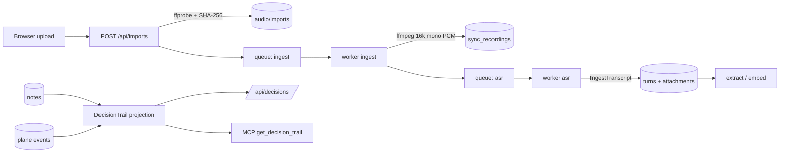

# Design

## Context

基线：`feat/memory-highlights-context-brief` @ `3f2865e9d2f41f4d03bc982d1ed8a2958e450433`。现有实现为 Go + SQLite + React；`internal/process` 提供持久化租约队列，`internal/plane` 是 append-only 事件平面，`internal/app.WorldlineService` 从 notes 与事件平面生成 claims。迁移最高版本 19。

## Goals / Non-Goals

目标：本地一条命令启动、浏览器导入录音、可理解的阶段进度、六态决策轨迹（Web + MCP）、可复现验证材料。

非目标：重写 Event Plane/Worldline/ASR Pipeline/检索主体；修改 ingest-v1；把 v2 检索设为默认；接入真实付费 ASR 作为默认路径。

## Decisions

D1 部署：单镜像多命令，`web` 与 `worker` 为两个 compose service，共享命名卷 `recording-mcp-data:/data`，profile 根为 `/data/profiles`。运行镜像基于 `debian:bookworm-slim`，UID/GID 10001，`read_only` + `tmpfs /tmp`，宿主只发布 `127.0.0.1:8788`，容器内经显式 `--container-bind` 监听 `0.0.0.0:8788`。

D2 上传：`POST /api/imports` 使用 multipart 字段 `file`，上限 2 GiB；扩展名白名单后仍用 `ffprobe` 探测音轨与时长，探测失败返回 `invalid_audio`；流式写入 profile 私有 `audio/imports/`，SHA-256 决定稳定的 provider recording/conversation ID。

D3 任务：上传只入队 `ingest`；`ingest` 用 `ffmpeg` 转 16 kHz mono s16le PCM 并写 `sync_recordings`，再幂等入队 `asr`；`asr` 复用 `cloudsync.Transcriber` 产生 `asrinput.Result`，逐个调用 `memory.Store.IngestTranscript`，由后者继续入队 `extract`/`embed`。不新增第二套队列。

D4 阶段投影：`ProcessingSnapshot` 增加 `phases`（`ingest/asr/extract/publish/index`）、`current_stage`、`asr_provider`、`asr_available`、`worker_alive`；无 job 的 `publish/index` 在前序完成时为 `skipped`（无候选可发布 / embedding 关闭）。保留原始 `jobs` 字段。

D5 检索：默认永远 `v1`；v2 只在显式 `retrieval_version=v2` 时启用。报告区分"返回无关候选""证据不足""错误宣称充分""无证据事实"四类错误；无人工 assessor 时 sufficiency 记 `NOT_RUN`，不得写 0%。

D6 决策：轨迹在读取时由 Worldline current claims 与 `decision.review` 事件确定性投影；一个 macro topic 只保留一个当前决策槽。候选由规则 `rule-v1` 从 claim 文本 cue 提取，`candidate_source` 明确写 `rule-v1`；确认只来自人工 review 事件。`valid_from` 未给出时保持空，绝不推断；`known_at` 使用系统记录时间。

D7 MCP：只新增只读工具 `get_decision_trail`，响应 `schema_version: "decision-trail-v1"`；不改现有工具字段；profile 模式使用 profile 的 `plane/events.db`。

D8 演示：演示转写使用明确标记的 fixture transcript；真实 ASR/embedding 未配置时记 `NOT_RUN` 并提供命令；只用临时目录，不读取 `data/` 下的私人录音。

D9 安全：任何脚本不得删除固定用户数据库；`context-eval` 只接受脚本创建的临时路径。

## Data Flow

## Error Semantics

- `asr_unavailable`（409）：未配置 ASR provider；`details.action` 给出配置步骤。
- `unsupported_format`（415）、`invalid_audio`（422）、`file_too_large`（413）、`import_disabled`（503）。
- 决策：`decision_version_conflict`（409）、`decision_request_conflict`（409）、`decision_not_found`（404）、`validation_failed`（400）。

## Time Semantics

`valid_from/valid_until` 只来自显式输入或来源 claim，未知保持 `null`；`mentioned_at` 是来源提到的时间；`recorded_at` 是系统记录时间；`known_at` 历史视图只过滤 `recorded_at <= known_at` 的复核事件与已知 `mentioned_at` 的候选。

## Byte Budget

`get_decision_trail` 默认 `max_bytes=16000`，夹在 256..262144。超预算时依次：丢弃最旧 history、截断证据文本到 512 字节、清空 history 与 evidence、从尾部截断当前/候选文本；`truncated=true`。

## Risks / Trade-offs

- fixture transcript 可能被误当作真实转写：所有输出显式标注 `transcript_origin`。
- WAL 需要可写目录；只读卷启动直接失败而不是静默回退。
- 决策投影依赖规则 cue，可能漏召回：状态仍保持 `observation/proposal`，不自动确认，降低误报优先级高于召回。

## Migration Plan

v20 为 `worker_heartbeats` 增加 ASR/embedding 能力列；v21 为 `recordings` 增加 `source_bytes`。两者都是幂等 `ALTER TABLE ... ADD COLUMN`，仅新增。仅在临时数据库验证升级，不访问真实用户库。
